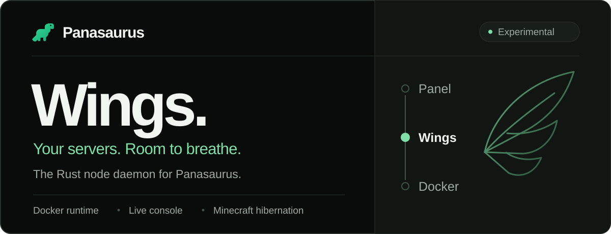
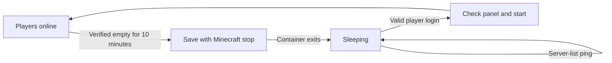

<p align="center">
  
</p>

<p align="center">
  <strong>Rust 2024</strong> &nbsp; / &nbsp; <strong>Docker</strong> &nbsp; / &nbsp; <strong>HTTP + WebSocket</strong>
</p>

<p align="center">
  <a href="#get-running">Get running</a> &nbsp; · &nbsp;
  <a href="#what-works-today">Capabilities</a> &nbsp; · &nbsp;
  <a href="#let-empty-worlds-sleep">Hibernation</a> &nbsp; · &nbsp;
  <a href="#under-the-hood">Under the hood</a> &nbsp; · &nbsp;
  <a href="https://github.com/panasaurus/panel">Panasaurus Panel</a>
</p>

<br />

# The engine beneath your worlds.

Panasaurus Wings connects your panel to the containers running your game servers.
Built in Rust, it handles server lifecycle, live console streams, confined file
access, disk quotas, and opt-in Minecraft Java hibernation.

When an empty world goes to sleep, it saves first. When a player joins, Wings can
bring it back. Server-list pings leave it sleeping.

> **Development preview · v0.1.0**
>
> This daemon implements part of the
> [Wings HTTP and WebSocket protocol](https://github.com/pterodactyl/wings/tree/develop/router)
> for local development and compatibility testing. It is not a complete upstream
> Wings replacement. Review [the current limits](#current-limits) before deployment.

## What works today

| | What Wings handles |
| :--- | :--- |
| **Server lifecycle** | Create, install, start, stop, restart, kill, and rebuild containers while retaining existing server data. |
| **Live console** | Authenticated WebSocket logs, container stdin commands, Docker system information, and live resource usage. |
| **File access** | Directory listings, reads and writes up to 1 MiB, recursive deletion, and the panel's EULA acceptance flow. |
| **Bounded storage** | Fixed-capacity disk images, confined paths, egg denylist enforcement, and checks against symlink and hardlink aliases. |
| **Resource controls** | Synchronize memory, swap, CPU, and CPU affinity through Docker. Fetch fresh panel configuration on start and restart. |
| **Minecraft hibernation** | Save and sleep verified empty Java servers; wake on valid login with fresh assignment and suspension checks. |

## Get running

You need a Rust toolchain supporting edition 2024, Docker Engine with its CLI,
and a node configured in [Panasaurus Panel](https://github.com/panasaurus/panel).
Wings invokes the Docker CLI directly.

| Host | Storage requirements |
| :--- | :--- |
| **Linux** | Root privileges, `mkfs.ext4`, `mount`, `findmnt`, and `losetup` for ext4 loop images. Minimum supported quota: 16 MiB. |
| **macOS** | HFS+ sparse disk images. Docker and Wings must see the same absolute volume path. |

### 1. Build the daemon

```sh
git clone https://github.com/panasaurus/wings.git
cd wings
cargo build --locked --release
```

### 2. Connect your panel

Create a node using the **Wings** daemon type. Save the configuration generated by
the panel as `config.yml`, then add the Docker settings from
[config.example.yml](config.example.yml).

The example contains placeholders; replace them with your node's real credentials.

| Setting | What to use |
| :--- | :--- |
| `uuid`, `token_id`, `token` | The credentials generated for this node by the panel. |
| `remote` | The panel URL used as the JWT issuer. |
| `jwt_audience` | The node's internal connection address, including scheme and port; it must match the panel's JWT audience. |
| `api.host` | A loopback IP such as `127.0.0.1` or `::1`. |
| `system.data` | An absolute volume path visible at the same location to Wings and Docker. |
| `docker.user` | A container user with permission to write to the volume directory. |
| `allowed_origins` | The browser origin of your panel. |

### 3. Start Wings

```sh
chmod 600 config.yml
target/release/panasaurus-wings --config config.yml
```

Keep credentials private. The API must use a loopback listener; direct TLS is not
implemented and plaintext wildcard listeners are refused. Remote access requires
a TLS reverse proxy and network restrictions. The missing hosting features listed
below still need to be implemented before serving customers.

## Let empty worlds sleep

Minecraft Java hibernation frees resident CPU and RAM when nobody is playing.
Running servers keep their configured limits and share the freed node capacity.



**Save before sleep. Wake on a real join. Keep manual stops off.**

Merge [hibernation.example.yml](hibernation.example.yml) into your private node
configuration, using the server UUID, its Minecraft Java egg UUID, and its exact
primary IPv4 allocation. Keep `enable-status=true` in `server.properties`.

Stop the old container before restarting Wings, then start the server from the
panel so Wings can recreate its TCP mapping. The listener port must be available.
Worlds and files are retained. Configuration changes require a daemon restart;
after changing allocation addresses, start the server manually once.

| Behavior | Default |
| :--- | :--- |
| Idle window | 10 minutes of verified zero players |
| Startup grace | 2 minutes |
| Failed-wake cooldown | 60 seconds |
| Concurrent wake starts | 4 per node |
| TCP connections | 1,024 per node, plus the configured per-server limit |

<details>
<summary><strong>How sleep and wake stay predictable</strong></summary>

<br />

- Players, connected or pending login streams, and missing or invalid status
  responses reset the idle timer. A fresh status check and the server operation
  lock protect the save/stop transition.
- Wings sends Minecraft's `stop` command and waits for the container to exit.
  It never force kills a server that exceeds the save timeout.
- Server-list pings use cached status. A valid Login Start wakes an automatically
  sleeping server once, after fresh panel assignment, egg, allocation, and
  suspension checks. Manually stopped servers stay off.
- Sleep state is written atomically in the private `.hibernation` directory,
  outside game mounts, and survives daemon restarts.
- Cold boots can exceed the Minecraft client's login timeout. Reconnect after
  the server finishes starting.
- Authenticated server details and console statistics include enablement, sleep
  state, player count, idle timeout, and observation errors. Existing running and
  offline state values remain compatible with the panel. A dedicated sleeping
  badge and hibernation configuration form are not yet available in the panel.

</details>

<details>
<summary><strong>Networking and game compatibility</strong></summary>

<br />

Wings owns the public Minecraft TCP port and publishes the container's primary
TCP port on an automatically assigned loopback port. Wings and Docker must run
on the same host, or use a development Docker context that forwards loopback
ports to that host. Secondary TCP allocations and UDP mappings retain their
existing mappings. UDP traffic cannot wake a sleeping server.

This adapter supports ordinary Minecraft Java status and login handshakes.
Login and subsequent bytes are forwarded without changing online-mode
authentication. Backends see the proxy address; IP bans and IP-based plugins
need a separate, trusted forwarding integration before public hosting.

Hytale, Bedrock, legacy Java pings, transfer handshakes, and proxy forwarding
authentication are not implemented by this adapter.

</details>

## Under the hood

The panel assigns servers. Wings manages the node. Docker runs the containers.

```text
Panasaurus Panel
    │  Node configuration, server assignments, authenticated requests
    ▼
Panasaurus Wings
    ├── HTTP API + WebSocket console
    ├── Confined files + fixed-capacity storage
    ├── Minecraft Java sleep / wake proxy
    ▼
Docker CLI → Game server containers
```

<details>
<summary><strong>Authentication, files, and operation limits</strong></summary>

<br />

**Authentication.** Wings validates panel JWT signatures, issuer, audience,
server, scope, expiry, permissions, and revocations.

**Writes.** File operations use capability-based paths confined to the server
directory. Writes enforce egg denylist patterns, reject symlink and hardlink
aliases, and check aggregate disk usage while holding the server operation lock.
The panel selects `/files/create` or `/files/update` for users with only one file
permission; these endpoints exclusively create or open an existing file.
Daemons without those endpoints reject scoped requests instead of granting
extra privileges. Owners and users with both permissions use `/files/write`.

**Deletion.** Requests accept the panel's `root` and `files` fields, including
recursive folders and bulk selections. Symlinks are unlinked without following
their targets. Root deletion and parent traversal are rejected. All selected
trees are checked for denylist protection before deletion, and paths are checked
again during removal. Missing paths are treated as already removed.

Writes, deletion, and installation share the server operation lock. Write and
delete tasks retain their lock if the HTTP request disconnects.

| Limit | Bound |
| :--- | :--- |
| Read or write payload | 1 MiB |
| Selected deletion paths | 10,000 per request |
| Deletion traversal | 100,000 entries / 128 directory levels |
| File usage scans | 100,000 entries / 128 directory levels |
| Console connections | 128 per node / 16 per server / 2 per account per server |
| Console authentication | One attempt per second |
| Console messages | 20 per second |

Console connections share resource and log polling for each server. File usage
scans use confined directory handles.

</details>

<details>
<summary><strong>Disk images, container isolation, and resource changes</strong></summary>

<br />

**Storage.** Server storage uses HFS+ sparse images on macOS and ext4 loop images
on Linux. `build.disk_space` is honored in MiB. A zero allocation uses
`system.default_disk_limit_mb`, which defaults to 20,480 MiB. Filesystem metadata
consumes part of the allocation.

Images live in `.quota-images` outside container mounts. Game files live in each
image's `.server-data` directory, separating filesystem metadata from files
exposed to the panel and container. Existing files migrate only when creating
an offline container; originals remain in `<uuid>.backup`. A failed migration
blocks startup. Back up the image and resize it offline before changing disk
allocations.

**Containers.** Runtime containers use read-only root filesystems, a bounded
64 MiB `/tmp`, and rotated logs capped at three 10 MiB files. Docker's private
data directory still needs capacity for images and installer layers. Installation
scripts are trusted administrator code. Stop and recreate existing containers
to apply filesystem protection.

**Resources.** Memory, swap, CPU, and CPU affinity synchronize through Docker
update. Removing an existing limit, or changing configuration that requires a new
container, returns an actionable conflict while the server is running. Start and
restart fetch current panel configuration and recreate the container if needed.
The panel reports failed daemon syncs. Disk allocation changes require offline
image resizing.

</details>

<details>
<summary><strong>Panasaurus panel's local Colima setup</strong></summary>

<br />

The panel checkout keeps its private configuration in `.local/wings/config.yml`
and uses the `colima-panasaurus` Docker context.

| Connection | Address |
| :--- | :--- |
| Browser → node | `http://localhost:8081` |
| Panel → node | `http://host.lima.internal:8081` |
| Node → panel | `http://localhost:8080` |

Credentials and runtime data are ignored by Git.

</details>

## Current limits

This is an experimental implementation. Unsupported HTTP operations return
`501`. These features are not implemented:

| Area | Missing features |
| :--- | :--- |
| Files | Other file operations, SFTP, uploads, and downloads |
| Data movement | Backups and transfers |
| Egg behavior | Configuration-file rewriting and graceful egg-specific stop commands |
| Recovery | Automatic crash recovery |
| Node configuration | Direct TLS and live configuration updates |

Ordinary stop uses Docker's termination signal with a 15-second grace period;
Minecraft hibernation uses its separate save/stop flow. Installer containers
have a five-minute timeout. Runtime image entrypoints must launch `STARTUP`, as
Pterodactyl yolk images do.

## Development

Run the Rust test suite:

```sh
cargo test --locked
```

On macOS, build and run the hibernation lifecycle fixture:

```sh
cargo build --locked
python3 tests/hibernation.py
```

The fixture uses a temporary quota image, simulated Minecraft endpoint, and
recording Docker executable. It checks idle saving, unknown and active player
counts, persistent sleep state, status pings, malformed logins, simultaneous
joins, opaque stream forwarding, suspension, manual stop, failed-wake cooldown,
save timeout, and deletion cleanup. It does not modify existing panel servers.

---

<p align="center">
  <strong>Part of Panasaurus.</strong><br />
  Built for the worlds you run.
</p>

<p align="center">
  <a href="https://github.com/panasaurus/panel">Panel</a> &nbsp; · &nbsp;
  <a href="https://github.com/panasaurus/wings">Wings</a> &nbsp; · &nbsp;
  <a href="config.example.yml">Node configuration</a> &nbsp; · &nbsp;
  <a href="hibernation.example.yml">Hibernation configuration</a>
</p>
