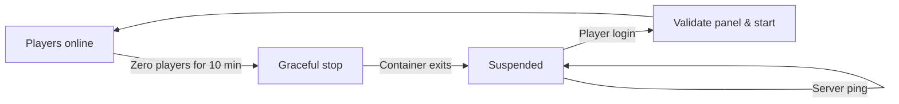

<p align="center">
  
</p>

<p align="center">
  <strong>Rust 2024</strong> &nbsp; / &nbsp; <strong>Docker</strong> &nbsp; / &nbsp; <strong>HTTP + WebSocket</strong>
</p>

<p align="center">
  <a href="#quick-start">Quick start</a> &nbsp; · &nbsp;
  <a href="#capabilities">Capabilities</a> &nbsp; · &nbsp;
  <a href="#minecraft-hibernation">Hibernation</a> &nbsp; · &nbsp;
  <a href="#architecture">Architecture</a> &nbsp; · &nbsp;
  <a href="https://github.com/panasaurus/panel">Panasaurus Panel</a>
</p>

<br />

# Panasaurus Wings

Panasaurus Wings is a Rust server control daemon for game server management panels.
It interfaces directly with Docker to manage server container lifecycles, stream live console logs over WebSockets, enforce disk quotas, control file system permissions, and handle optional Minecraft Java server hibernation.

> **Development status · v0.1.0**
>
> Wings implements the HTTP and WebSocket protocol endpoints required for game server panel management. Review [current limitations](#current-limitations) prior to production deployment.

## Capabilities

| Feature | Description |
| :--- | :--- |
| **Server Lifecycle** | Create, install, start, stop, restart, kill, and rebuild containers while preserving server data. |
| **Live Console** | Authenticated WebSocket log streaming, container stdin input, Docker system metrics, and real-time resource tracking. |
| **File Management** | Directory listings, file read/write up to 1 MiB, recursive deletion, and automated EULA acceptance flows. |
| **Bounded Storage** | Fixed-capacity disk quotas, path sandboxing, egg file denylist enforcement, and symlink/hardlink protection. |
| **Resource Limits** | Synchronize memory, swap, CPU usage, and CPU pin sets via Docker. Refresh panel config on server startup. |
| **Minecraft Hibernation** | Automatically pause empty Java servers and wake them when players connect. |

## Quick Start

### Requirements
- Rust toolchain (2024 edition)
- Docker Engine with CLI access
- [Panasaurus Panel](https://github.com/panasaurus/panel) node instance

| Host OS | Requirements |
| :--- | :--- |
| **Linux** | Root privileges, `mkfs.ext4`, `mount`, `findmnt`, and `losetup` for ext4 loop images (minimum 16 MiB quota). |
| **macOS** | HFS+ sparse disk images. Docker and Wings must share identical volume paths. |

### 1. Build the Daemon

```sh
git clone https://github.com/panasaurus/wings.git
cd wings
cargo build --locked --release
```

### 2. Configuration

Create a node in the panel, save the generated credentials to `config.yml`, and merge Docker settings from [config.example.yml](config.example.yml).

| Setting | Usage |
| :--- | :--- |
| `uuid`, `token_id`, `token` | Node credentials issued by the panel. |
| `remote` | Panel base URL (JWT issuer). |
| `jwt_audience` | Internal connection URL for the node, matching panel configuration. |
| `api.host` | Loopback IP address (`127.0.0.1` or `::1`). |
| `system.data` | Absolute storage directory path accessible to both Wings and Docker. |
| `docker.user` | Container user UID/GID allowed to write to the volume directory. |
| `allowed_origins` | Panel browser origin for CORS validation. |

### 3. Run

```sh
chmod 600 config.yml
target/release/panasaurus-wings --config config.yml
```

> **Security Note:** Keep `config.yml` private. The API must bind to a loopback address (`127.0.0.1` or `::1`). Use a TLS reverse proxy (e.g. Nginx, Caddy) to expose the API publicly.

## Minecraft Hibernation

Hibernation suspends inactive Minecraft Java processes to release CPU and RAM capacity when no players are connected.



### Setup

1. Add server routing settings from [hibernation.example.yml](hibernation.example.yml) into `config.yml`.
2. Ensure `enable-status=true` is set in the server's `server.properties`.
3. Stop existing server containers before starting Wings so TCP port bindings can be recreated.

| Setting | Default |
| :--- | :--- |
| Idle window | 10 minutes (zero players verified) |
| Startup grace | 2 minutes |
| Failed-wake cooldown | 60 seconds |
| Concurrent wake limit | 4 per node |
| Max TCP connections | 1,024 per node |

<details>
<summary><strong>Hibernation Details</strong></summary>

<br />

- **Idle Detection:** Active players, pending logins, or status query failures reset the idle timer.
- **Graceful Shutdown:** Sends Minecraft `stop` command and waits for clean container termination.
- **Server Pings & Wake:** Server-list pings return cached status responses. Valid player login handshakes trigger node validation and container wake.
- **Persistence:** Sleep state is written atomically to `.hibernation/` in the node data path.
- **Networking:** Wings binds the external TCP allocation and proxies connections to the container's private port.

</details>

## Architecture

```text
Panasaurus Panel
    │  Node management, authentication, server metadata
    ▼
Panasaurus Wings (Daemon)
    ├── HTTP API + WebSocket Log Server
    ├── Sandboxed File System + Disk Quota Engine
    ├── Minecraft Sleep/Wake Proxy
    ▼
Docker Engine → Server Containers
```

<details>
<summary><strong>Security & Limits</strong></summary>

<br />

- **Authentication:** Panel JWT signatures, expiration, server scopes, permissions, and revocation lists are verified on every request.
- **Path Sandboxing:** File operations use capability-based sandboxing strictly within server directories.
- **Denylists:** Protected egg file patterns block read/write/delete attempts.
- **Symlink Protection:** Directory traversal rejects symlink escape attempts and hardlink aliases.

| Resource | Enforced Bound |
| :--- | :--- |
| File Read / Write Payload | 1 MiB |
| Deletion Batch Size | 10,000 files per request |
| File Traversal Limits | 100,000 entries / 128 directory levels |
| WebSocket Connections | 128 per node / 16 per server / 2 per user account |
| Console Rate Limits | 20 messages/sec, 1 auth attempt/sec |

</details>

## Current Limitations

| Area | Status |
| :--- | :--- |
| **Files** | SFTP, direct archive uploads, and download streaming endpoints are not included. |
| **Data Movement** | Remote server transfers and automated panel backups are not implemented. |
| **Egg Hooks** | Configuration file rewriters are not integrated. |
| **TLS** | Direct TLS terminates at reverse proxies; HTTP API binds to loopback. |

## Development

Run tests:

```sh
cargo test --locked
```

Run hibernation test fixture:

```sh
cargo build --locked
python3 tests/hibernation.py
```

---

<p align="center">
  <a href="https://github.com/panasaurus/panel">Panel</a> &nbsp; · &nbsp;
  <a href="https://github.com/panasaurus/wings">Wings</a> &nbsp; · &nbsp;
  <a href="config.example.yml">Example Config</a>
</p>
